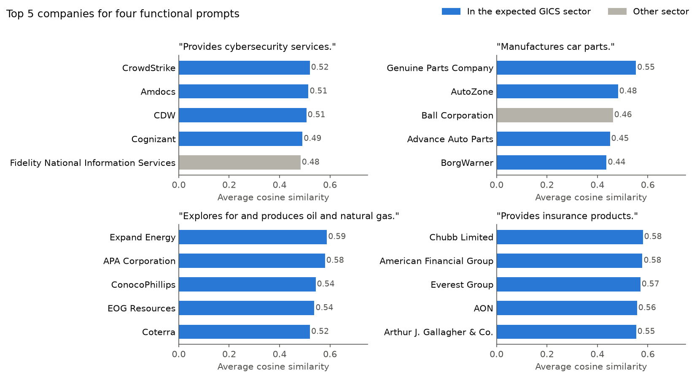
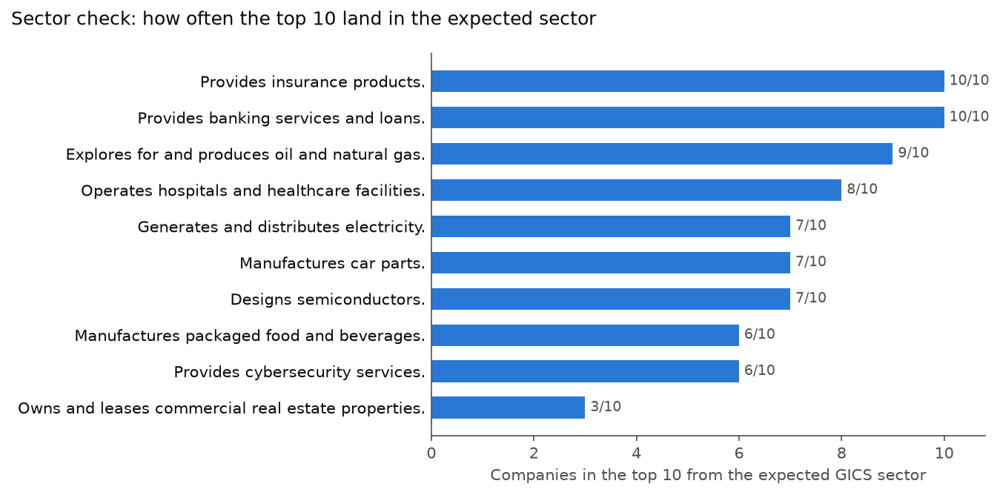

<h1 align="center">Functional Company Search</h1>

<p align="center">
  Finding companies by what they actually do: type a plain-English prompt and rank companies by how closely their business descriptions match it, using SBERT sentence embeddings.
</p>

<p align="center">
  
  
  <a href="LICENSE"></a>
</p>



## Overview

Industry codes like GICS put each company in one bucket, which misses companies that do the same kind of work under a different label. This project searches business descriptions directly. Given a prompt like "Provides cybersecurity services.", it scores every sentence of every description against the prompt and returns the companies whose descriptions match best.

The search runs over 424 Russell 1000 companies with business descriptions from Yahoo Finance. All of the work is in [`notebooks/Business_Description_Similarity.ipynb`](notebooks/Business_Description_Similarity.ipynb).

## Approach

- **Sentence splitting.** Split each description into sentences with NLTK (2,800 sentences in total).
- **Functional filtering.** Dropped sentences about location, history and naming ("headquartered in", "founded in", "formerly known as" and similar phrases, matched as whole words). That removes 533 sentences and keeps 2,267 that describe what the company does.
- **Embeddings.** Encoded each sentence with [`multi-qa-mpnet-base-cos-v1`](https://huggingface.co/sentence-transformers/multi-qa-mpnet-base-cos-v1), an SBERT model trained for semantic search, using its mean pooling and normalization.
- **Search.** Encoded the prompt with the same model, computed cosine similarity against every sentence, averaged the scores per company, and ranked companies by that average.
- **Sanity check.** Ran ten prompts that each point to one GICS sector and counted how many of the top 10 companies fall in that sector.

## Results

Top 5 for "Provides cybersecurity services.":

| Company | GICS sector | Average similarity |
|---------|-------------|-------------------:|
| CrowdStrike | Information Technology | 0.5199 |
| Amdocs | Information Technology | 0.5145 |
| CDW | Information Technology | 0.5063 |
| Cognizant | Information Technology | 0.4908 |
| Fidelity National Information Services | Financials | 0.4832 |

- Across the ten test prompts, **73% of the top 10 companies** are in the GICS sector the prompt points to. Banking and insurance get 10/10 and oil and gas gets 9/10.
- Some misses are near matches. Packaging makers (Ball, Berry Global, Crown Holdings, Amcor) show up for "Manufactures packaged food and beverages."
- The real estate prompt is the weakest (3/10). Its top 10 scores are low and bunched together (0.36 to 0.39), so the search can't separate the REITs from banks and utilities.



## Data

- **Companies:** the Russell 1000 constituents table on [Wikipedia](https://en.wikipedia.org/wiki/Russell_1000_Index) (company, ticker, GICS sector and sub-industry).
- **Descriptions:** the long business summary for each ticker from Yahoo Finance, pulled with [yfinance](https://github.com/ranaroussi/yfinance).

Yahoo Finance rate limited the original pull, so only 424 companies came back, almost all with names starting A to G. That pull is saved in `Data/company_bd_data.csv`, and the notebook loads it by default.

## Limitations

- **Partial universe.** The search only covers the 424 companies in the saved pull, not the full Russell 1000.
- **Average scoring.** Averaging over every sentence favors companies whose whole description is on topic and can bury a company where only one business segment matches the prompt. Ranking on each company's best few sentences is worth testing.
- **Rough evaluation.** The GICS sector check is a sanity check, not a measure of accuracy. There's no labeled set of correct matches for a functional search.
- **Keyword filter.** The functional filter is a fixed phrase list, so it can drop a sentence that mixes history with operations, and it keeps boilerplate it doesn't know about.

## Getting started

### Prerequisites

- Python 3.12

### Installation

```bash
git clone https://github.com/Yahlawat/Functional-Company-Search.git
cd Functional-Company-Search

python3 -m venv .venv
source .venv/bin/activate

pip install -r requirements.txt
```

### Data

The business descriptions are included in `Data/company_bd_data.csv`. To pull fresh data from Wikipedia and Yahoo Finance instead, set `REFRESH_DATA = True` in the notebook. This is slow and can hit the same Yahoo Finance rate limit. The sentence embeddings aren't in the repo; the notebook rebuilds them each time it runs.

### Run

```bash
jupyter notebook notebooks/Business_Description_Similarity.ipynb
```

The first run downloads the SBERT model from Hugging Face (about 440 MB). After that the notebook runs in under a minute on a laptop CPU. To search for your own prompt, change `query` in section 5. Tested with Python 3.12, pandas 3.1, PyTorch 2.14, sentence-transformers 6.2 and NLTK 3.10.

## Project structure

```
.
├── notebooks/
│   └── Business_Description_Similarity.ipynb   # Full pipeline
├── Data/
│   ├── company_bd_data.csv                     # Company list and business descriptions
│   ├── similarity_results.csv                  # Top 5 for the example query
│   └── Embeddings/bd_embeddings.pt             # Sentence embeddings (made by the notebook, not tracked)
├── images/                                     # Figures saved by the notebook
├── requirements.txt
├── LICENSE
└── README.md
```

## License

The code is released under the [MIT License](LICENSE). The business descriptions in `Data/company_bd_data.csv` come from Yahoo Finance and the companies themselves. They're included for research and educational use only and aren't covered by the MIT License.
